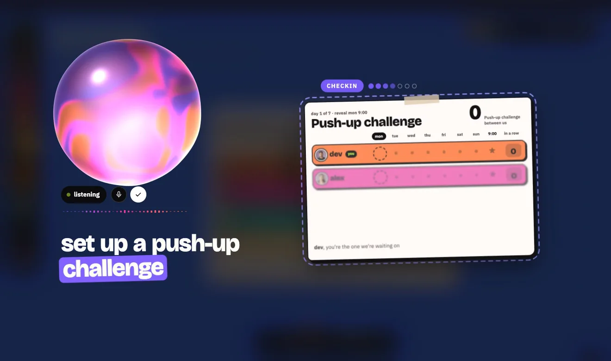
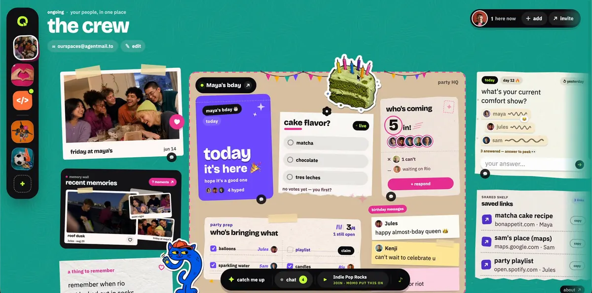
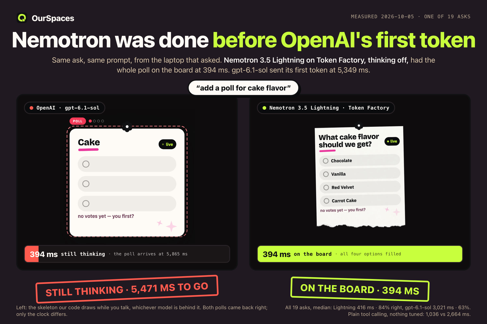
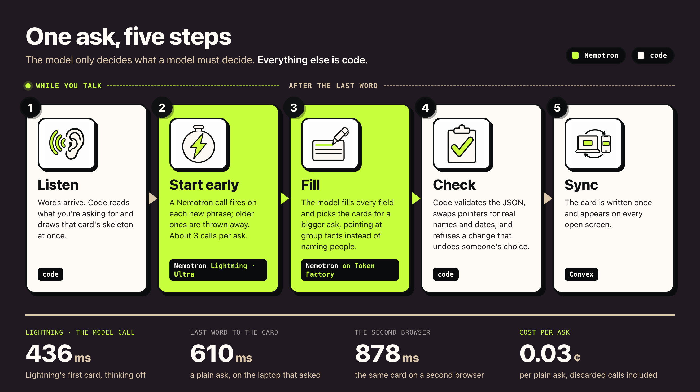
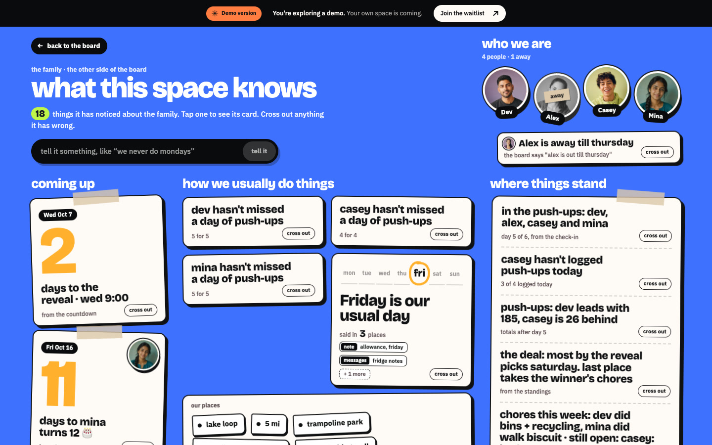
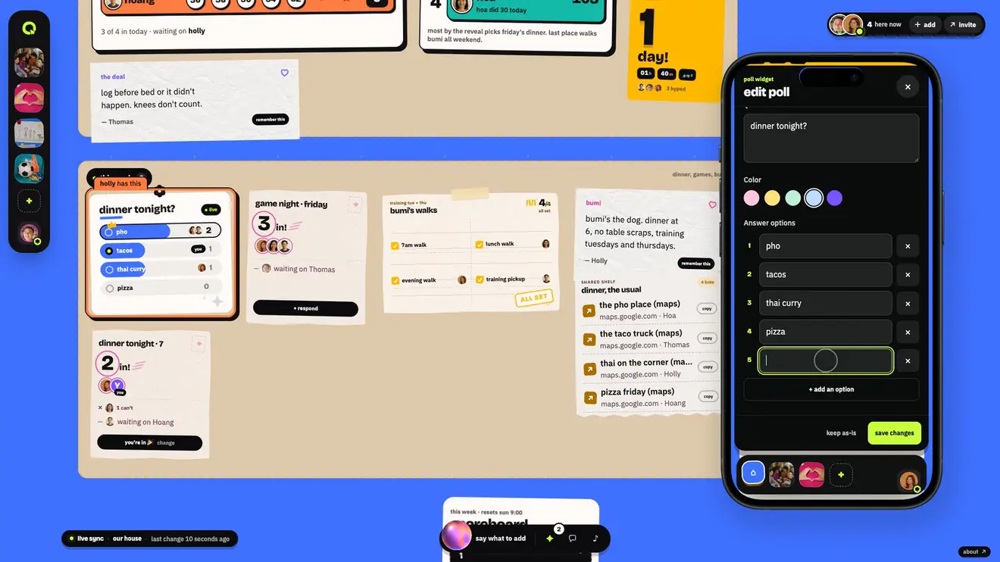
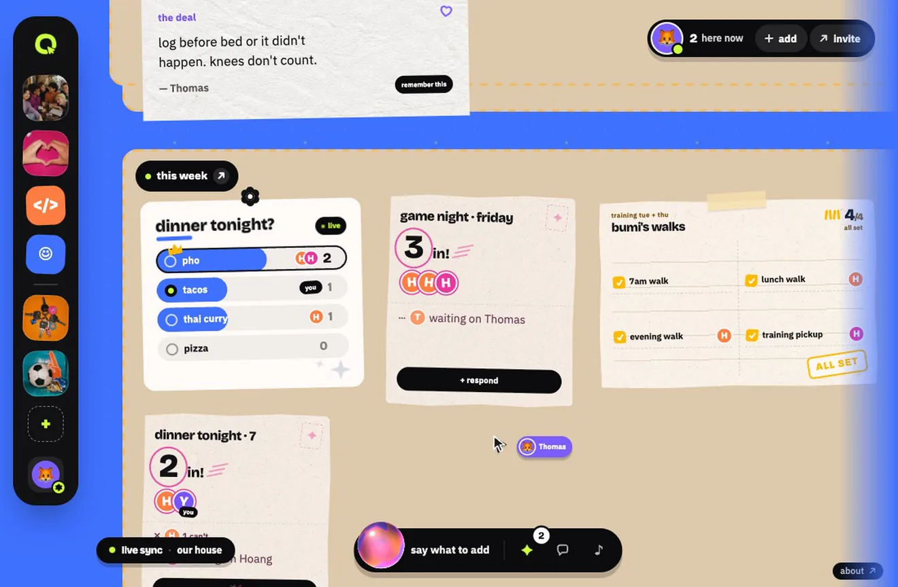

# OurSpaces

> Say "poll for Saturday" and the poll is on your friends’ page. The AI never cuts in.

A shared board for your group that builds itself when you talk to it. Tap the
orb, say what you need, and the card lands on your screen 610 ms after your
last word (878 ms on everyone else's), filled in by **NVIDIA Nemotron on
Nebius Token Factory**. Then it's a normal card anyone can vote on, claim or drag.

**Live:** https://ourspaces.io · **Video:** https://youtu.be/A4gXhmU9Eeo ·
**Built for** the Nebius × NVIDIA Global AI Hackathon · **By** Thomas Nguyen
(build) and Holly Tran (design)

<p align="center"><picture><source srcset="https://raw.githubusercontent.com/thomasnguyen/ourspaces-app/main/.github/readme/loop-challenge.avif" type="image/avif"></picture></p>
<p align="center"><sub>"Set up a push-up challenge for the four of us": the first card lands under a second after the last word (990 ms), all six by 1.6 s.</sub></p>

## What you can say

| You say | What happens on every screen |
|---|---|
| "Add a poll for Saturday dinner" | A real poll, 610 ms after your last word |
| "Add ramen to the dinner poll" | A real ramen place nearby, found on the web by Tavily, in a room that knows its city |
| "Who's driving to Maya's?" | A wheel with exactly the four people who said yes |
| "Set up a push-up challenge for the four of us" | Six linked cards: who's in, a check-in grid, face-down standings, the deal, a countdown |
| "Add a poll for cake flavor" (one exists) | Nothing new; it takes you to that poll |

<p align="center"></p>
<p align="center"><sub>Then it's the group's board: zoom into any card, and each one has its own thread.</sub></p>

## How one ask works

**The model only decides what a model must decide.** It fills every field and
picks the cards for a bigger ask. Code picks the action, places the card,
checks the write, and turns pointers like "the people who are coming" into
real names, so the model can't invent one.





| Model, on Token Factory | Job | Measured |
|---|---|---|
| `nvidia/Nemotron-3_5-Lightning`, thinking off | Plain asks; picks web places | First card in 436 ms (313 ms inside the Convex action) |
| `nvidia/Nemotron-3-Ultra-550b-a55b` | Group-fact asks, multi-card asks, questions | Right cards 15 of 15 on multi-card chains (Lightning: 6 of 15) |
| `nvidia/nemotron-3-super-120b-a12b`, thinking on | Game setup, the weekly email | Nobody waits on it; 1.0 to 1.6 s per game |

- **Why Token Factory.** Thinking is on by default (Lightning spent all 600
  tokens reasoning, 0 valid answers in 6); `chat_template_kwargs.enable_thinking=false`
  turns it off, and the 436 ms rests on that. Four sizes behind one endpoint,
  so moving a job is one constant.
- **It starts before you finish.** A call fires while you're still talking and
  is thrown away if you keep going: about 3 calls per ask, **0.03 cents** for a
  plain one, discarded calls included. p90 657 ms; worst seen 1.85 s, the first
  ask after a deploy.

**What Nemotron adds**, same asks with every model call switched off:

| Test | Rules only | With Nemotron |
|---|---|---|
| Asks that need the group's facts (10) | 1 | 9 |
| Plain asks, fields filled correctly (8) | 2 | 7 |
| The push-up challenge, 10 runs | one empty card | six cards, the right four people, 10 of 10 |

Each space has a page of **what this space knows**: every line shows its
source, and anyone can cross one out.



## Right of way: the AI waits its turn

An AI acting for a group fails one way: it changes what a person is in the
middle of, or undoes a choice they made. **The model proposes; a lease table in
code decides.**

- A **lease** is a person's hand on a card (dragging, typing, holding a vote),
  shown as a halo with their name on every screen.
- An AI change to a held card **waits** as a ghost and lands when they let go.
- A change that would undo a vote or a claim **asks the people who made it**.
- Whoever asked can undo an AI change with one tap.

<p align="center"><picture><source srcset="https://raw.githubusercontent.com/thomasnguyen/ourspaces-app/main/.github/readme/loop-waits.avif" type="image/avif"></picture></p>
<p align="center"><sub>Holly is typing in the dinner poll on her phone; Thomas's "add ramen" from his laptop waits on her, fills in from the web, and lands when she lets go.</sub></p>

**Why not just ask the model?** 162 situations labelled by hand, 64 of them
from our recorded test sessions. Of the 155 clear ones, 107 would change
something a person holds or chose, 48 are harmless.

| Who decides | Harmful writes let through (of 107) | Harmless ones held (of 48) | Time per decision |
|---|---|---|---|
| The gate in code | 0 | 2 | about 1 µs |
| Nemotron Ultra, thinking on | 0 | 3 | 3,063 ms |
| Nemotron Ultra, thinking off | 29 | 8 | 1,075 ms |

The honest loss: Ultra with thinking on let none through on its first, blind
run; the gate's 0 came after fixing the four misses this set named. What code
buys is 3 s and a model call on every write. Two browsers on the deployed app:
**38 of 38** AI changes to a held card waited. Scenarios and a replay: [`eval/right-of-way/`](eval/right-of-way/).

## Who uses it

- **Our house** (Thomas, Holly, Hoa, Hoang and Bumi the dog) has had its room
  since Oct 6, with our real names and facts. **Thomas's fantasy league** moves
  its votes in from Sunday, Oct 11. No counts yet; the counting query is built
  (`pilot:summary`), and the numbers go in this repo when there are any.
- Phones first: the first minute fits a phone screen, and it installs to a
  home screen.
- Games Nemotron sets up from the room's facts, with a shared reveal.

## Where it falls short

- A bigger model alone didn't help: with the group's facts pasted into the
  prompt, Lightning and Ultra both got 1 of 10. Pointers and worked examples
  took it to 9.
- The seeded family room's ten harder asks: 2 right, 5 partly right, 3 wrong.
- Scripted speech, not a real microphone; small tests we wrote ourselves, not
  recordings of real groups.

<p align="center"><picture><source srcset="https://raw.githubusercontent.com/thomasnguyen/ourspaces-app/main/.github/readme/loop-undo.avif" type="image/avif"></picture></p>

## Try it

1. Open [the crew](https://ourspaces.io/#/space/crew) in two tabs. Vote in
   one; the bar moves in the other.
2. Tap the orb and say "add a poll for Friday game night". It lands in both.
3. Grab a card in one tab and ask the orb to change it in the other. The
   change waits until you let go.

## What changed

New during the Nebius × NVIDIA submission period: the first commit (ccd8480)
landed Aug 26, 2026 at 10:09 pm PT, after the period opened that morning. The
first version (shared spaces with live widgets, 319 commits through Sep 21) was
also our Convex All Gas hackathon entry, which won on Oct 2; its AI ran on
OpenAI through the Convex AI Gateway. Since Oct 3 (215 of the repo's 534
commits): Nemotron on Token Factory behind every chat call, the voice orb and
card deck, Right of Way, the family room, games, Tavily lookups and the pilot
counting query.

## For the technical reader

<details>
<summary><b>How one ask runs, function by function</b></summary>

| Step | Where | What happens |
|---|---|---|
| 1. Listen | `src/lib/voice.ts` `useVoice` | Browser speech recognition; a pause of `PAUSE_MS` (650 ms) ends the ask |
| 2. Wake | `voiceBuild.warm` → `pingTokenFactory` (`convex/nebius.ts`) | Fired when listening starts, so the first call isn't cold |
| 3. Guess while talking | `src/live/useVoiceBuild.ts` `words` → `guessCard`, `existingFor` | Code shows the card's empty skeleton and checks whether that card is already on the board |
| 4. Early fill (speculative) | `maybeFire` → action `voiceBuild.deal` with `spec: true` | A model call on the words so far; at most `SPEC_MAX_CALLS` (6) per ask, `SPEC_IN_FLIGHT` (2) at once |
| 5. Decide (only when the words don't name one card, or the card may already exist) | action `voiceBuild.decide` → `chooseLetter` | Ultra answers one token (`max_tokens: 1`, `logprobs`, `top_logprobs: 20`): which card, is it on the board, which verb |
| 6. Spend check | `internal.guard.voice` (`convex/guard.ts`) | Before any model call: the day's dollar ceiling, then the per-seat and per-room limits |
| 7. Final fill | `pickFinal`, else `voiceBuild.deal` with `spec: false` | Reuses an early call made on the exact final words; otherwise fires one more |
| 8. Model call | `streamChat` (`convex/nebius.ts`) | Streamed, `temperature: 0`, `chat_template_kwargs: { enable_thinking: false }` |
| 9. Parse | `parseDeal` (`src/lib/deck/prompt.ts`), `parseDealResolved` (`promptV2.ts`) | One JSON line per card, parsed as each line closes |
| 10. Pointers to names | `resolveCard` (`src/lib/deck/resolve.ts`) | `@coming(...)` and the other pointers become real names, dates and places |
| 11. Check and place | `applyCard` (`src/lib/deck/apply.ts`), `placeCards` (`place.ts`) | Settings checked against the card's schema; a free spot on the board |
| 12. Write | mutation `voiceBuild.commit` → `rightOfWay` (`convex/rightOfWay.ts`) | The gate, then `ctx.db.insert("widgets")`; `noteCommitted` schedules the Tavily lookup after the card exists |
| 13. Sync | `spaces.getSpaceWithWidgets` | A reactive query: every screen in the room gets the card |

- **Models** (`NEMOTRON` in `convex/nebius.ts`): `deal` runs `FAST` = Lightning, `max_tokens` 220, on a plain ask; `BRAIN` = Ultra, 300, when the ask points at the group's facts. `decide` and spoken answers run on Ultra. Other jobs are in `NEMOTRON_BY_JOB` (`convex/ai.ts`): recap, ask and mail on Ultra with thinking off; questions on Lightning; the weekly digest on Super with thinking on.
- **Output format:** the voice path uses no `response_format` and no tool calling. The prompt asks for one `{"card":"<id>","settings":{...}}` per line, and code parses each line as it streams in. `completeJson` in `convex/ai.ts` uses `response_format: { type: "json_object" }` for the jobs off the voice path.
- **What is thrown away:** every early call carries a `seq`. An answer older than the one on screen is ignored (`sp.seq < s.shownSeq`); nothing is aborted. Early calls are logged in the `deals` table and never write a card. Only `commit` writes, and only for the final words.
- **"One exists":** `existingFor` (`src/lib/deck/existing.ts`) and the board question in `decide` (accepted at `DECIDE_BAR` 0.8). `pointAt` moves the view to the card, and nothing is written.

</details>

<details>
<summary><b>The deck: what the model can pick, what code fills</b></summary>

- **19 cards** in `CATALOG` (`src/lib/deck/catalog.ts`): poll, checklist, countdown, rsvp, wheel, note, question, availability, split, itinerary, messages, jokes, quote, decision, clocks, photos, checkin, standings, radio. Two more (`frame`, `signup`, in `INTERNAL`) are placed by code only.
- **Recipes** (`RECIPES`, `src/lib/deck/recipes.ts`): `challenge`, `dinner`, `hangout`, `cabin`, `potluck`. One line from the model, several linked cards from `expandRecipe`; the push-up challenge is `challenge`.
- **The model fills** the card id and its `settings` (title, options, items, a date) and nothing else. `deckPrompt()` shows only the cards on the ask's shortlist (`shortlist.ts`).
- **Code fills** everything else. `checkSettings` (`schema.ts`) applies defaults, clamps values and drops bad fields; `applyCard` makes the id and size; `placeCards` finds the spot; the author comes from the caller's seat (`seatOf`, `convex/seat.ts`), never from the model.
- **Pointers.** On the Ultra path the model writes pointers in place of names: 14 kinds in `TOKENS` (`resolve.ts`), among them `@coming(title)` (who said yes on that RSVP), `@everyone-but(...)`, `@payer`, `@leader(poll)`, `@date(title, -2d)`, `@headcount`. `resolveCard` expands them from the room's facts (`buildBrief`, `convex/roomBrief.ts`). An unknown pointer is left out, with a note; a known one with no fact behind it falls back (`coming` → the people not marked away). So a name a pointer produces is always a real member's.

</details>

<details>
<summary><b>Right of Way: the lease table and the gate</b></summary>

- **`leases`** (`convex/tables/rightOfWay.ts`): `spaceId`, `thing` (a card id or a puzzle piece), `kind`, `userId`, `name`, `color`, `since`, `until`, `letGoAt`, `settleAt`; index `by_thing` on `[spaceId, thing]`. The client renews a hold every `RENEW_EVERY_MS` (1 s, `src/live/useHolds.ts`). A hold lasts `RENEW_MS` (3 s, `convex/leases.ts`) past its last renewal, then `GRACE_MS` (1.5 s) after typing or a vote, `DRAG_GRACE_MS` (0.6 s) after a drag. The scheduled `leases.settle` ends it.
- **The gate** is a pure function, `rightOfWay(write, leases)` in `src/lib/rightOfWay.ts`: no clock, database or model. `convex/rightOfWay.ts` calls it inside the mutation that commits the write, so nothing changes between the check and the commit. Four verdicts:
  - `go`: committed now.
  - `wait`: stored in `pending` and shown as a ghost on every screen. When the lease settles, `landWaiting` runs the gate again and replays the write. If the card changed meanwhile, the write is `"dropped"` and the card says so. A wait expires after `WAIT_MS` (30 s).
  - `ask`: it would override votes, claims, RSVPs, payments, check-ins or a hand-set date, so it becomes a vote of those people (`choiceVotes`).
  - `never`: the last puzzle piece, or a new card on a held spot (that card is placed elsewhere).
- **The log:** every AI write is a row in `aiWrites` with its outcome. Whoever asked can take one back (`rightOfWay.cancel`).
- **The 162 situations** are public in [`eval/right-of-way/`](eval/right-of-way/). There are 45 from the gate's own cases, 64 recorded from our two-browser sessions and 53 adversarial ones, plus 18 appended later as batch `r4`. All were labelled by hand and frozen with a hash before either arm ran (`scenarios.mjs` → `scenarios.json`). `node eval/right-of-way/replay.mjs` runs the shipping gate on all 180 in under a second with no network; `--model ultra-think` scores the cached model answers in `answers/`; `--live` asks Token Factory again.

</details>

<details>
<summary><b>Data model and sync</b></summary>

- **34 tables:** 28 in `convex/tables/` (rooms, mail, voice, rightOfWay, games) plus the six Convex Auth tables (`users` is ours).

| Table | Indexes | Holds |
|---|---|---|
| `spaces` | `by_name`, `by_slug`, `by_inbox`, `by_owner` | A group's room |
| `members` | `by_space`, `by_space_user`, `by_user` | Who is in which room |
| `widgets` | `by_space`, `by_space_and_type`, vector `by_embedding` | Every card |
| `votes` | `by_widget`, `by_widget_user`, `by_user` | Poll votes |
| `leases` · `pending` | `by_thing` | Hands on cards; AI writes waiting on them |
| `choiceVotes` | `by_widget`, `by_space` | "Ask the people who chose" votes |
| `aiWrites` | `by_space` | Every AI write and its outcome |
| `deals` | `by_space` | Every voice model call, early ones included |

- **Functions:** 255 exported from `convex/*.ts`: 45 queries, 65 mutations, 10 actions, 1 HTTP action (`streaming.streamAsk`), and 134 internal ones.
  - **Reactive queries:** `spaces.getSpaceWithWidgets` (the board), `rightOfWay.room` (halos and ghosts), `roomPresence.onlineForSpace` (who's here).
  - **Actions:** the Token Factory calls (`voiceBuild.deal`, `decide`).
  - **Scheduled:** `leases.settle` at a hold's end, `rightOfWay.expire`, `tavily.lookup` after a card commits, `games.tick`, and six crons in `convex/crons.ts` (room briefs every 10 minutes, the daily catch-up, the weekly digest).
  - **HTTP** (`convex/http.ts`): `/api/ask-stream`, `/api/agentmail/webhook`, the auth routes.
- **18 components, each with a job:**
  - `presence`: the who's-here count.
  - `agentMail` (local, `convex/components/agentMail`): every space's inbox, and sign-in codes.
  - `firecrawl`: a dropped link becomes a card.
  - `rateLimiter`: the limits below.
  - `shardedCounter`: the day's spend and the live totals.
  - `aggregate` ×2: `pollTallies`, `memberCounts`.
  - `actionRetrier` and `actionCache`: Firecrawl retries and caching.
  - `workpool`: the daily recap fan-out.
  - `workflow`: the weekly digest.
  - `batchWorker`: refreshes stale link cards.
  - `agent`: "ask the space" threads.
  - `rag`: search for those answers.
  - `persistentTextStreaming`: streamed answers.
  - `migrations`.
  - `staticHosting`: serves the site.
  - `authWellKnown`: OIDC discovery.
- **Limits** (`convex/rateLimits.ts`):
  - **Deployment:** `SPEND_CEILING_USD = 0.5` per UTC day, estimated as tokens × `PRICE_PER_M`. `guard.voice` and `modelDoor` check it before every model call; past it, the orb says so and code-only answers keep working.
  - **Per seat:** `voicePerson` (50 a minute, burst 60).
  - **Per room per day:** `voiceRoomDay` (300 calls) and `tavilyRoomDay` (40).
  - **Per person:** the Firecrawl limits.
  - **A seat is proven by the session:** `seatOf` reads the caller's `members` row and ignores any name the client sends.
- **Embeddings:** `convex/rag.ts` uses `openai/text-embedding-3-small` through the Convex AI Gateway, the one model call not on Nemotron.

</details>

<details>
<summary><b>How the numbers were measured</b></summary>

| Number | How | Speech or direct call |
|---|---|---|
| 610 ms / 878 ms, p90 657 / 978 | Run V1 (Oct 5): 12 plain asks on the dev deployment, last word to card on the asker's screen and on a second browser. A re-run after games went in (G5): 618 / 883 | Scripted speech through the real voice path, two browsers |
| 0.03 cents a plain ask | V1: tokens × list price for every call the ask made, discarded early calls included ($0.0003) | Same runs |
| 436 ms (313 ms) | Latency spike (Oct 5): Lightning, prompt v2, thinking off. p50 to the first complete card over 50 requests from a laptop; 313 ms over 10 calls inside a Convex action | Direct model calls |
| Ultra 15 of 15 (Lightning 6 of 15) | Same spike: 15 multi-card chain asks per model, prompt v1, right cards per ask | Direct model calls |
| 38 of 38 | Run R1 (Oct 5): two browsers on the dev deployment. One holds a card (drag, typing, vote) while the other asks to change it; a subscription logged every committed version (0 changed while held) | Scripted speech |
| 0 of 107 / 29 of 107 | Run R3 (Oct 5): the 162 situations, 155 clear. 0 = the gate (5 on its blind run, 0 after the fixes listed in the eval README) and Ultra with thinking on; 29 = Ultra with thinking off. The gate runs in-process; the models at temperature 0, one call each, no retries. Every figure in [`eval/right-of-way/results.json`](eval/right-of-way/results.json) | Direct model calls; the gate is code |
| 203 commits | `git rev-list --count --since=2026-10-03 --until=2026-10-11 HEAD` (319 through Sep 21) | — |

</details>

## Stack and run

Every chat model call is Nemotron on Token Factory (`convex/nebius.ts`; search
embeddings stay on the Convex AI Gateway) · Convex (database, live sync, auth,
scheduling, the lease table and the Right of Way gate in `convex/rightOfWay.ts`)
· Tavily (real places nearby) · AgentMail (every space has an inbox) ·
Firecrawl (links become cards) · Vite + React + TypeScript · Tailwind v4.

```bash
npm install
npx convex dev        # once, to provision; writes .env.local
npm run dev           # frontend
```

On your Convex deployment: `NEBIUS_API_KEY` for every Nemotron call (without
it the AI returns canned text); `FIRECRAWL_API_KEY` and `AGENTMAIL_API_KEY`,
which `convex/convex.config.ts` requires; `TAVILY_API_KEY`, optional, for the
lookup (add your deployment's name to `LANES` in `convex/tavily.ts`). MIT License.
