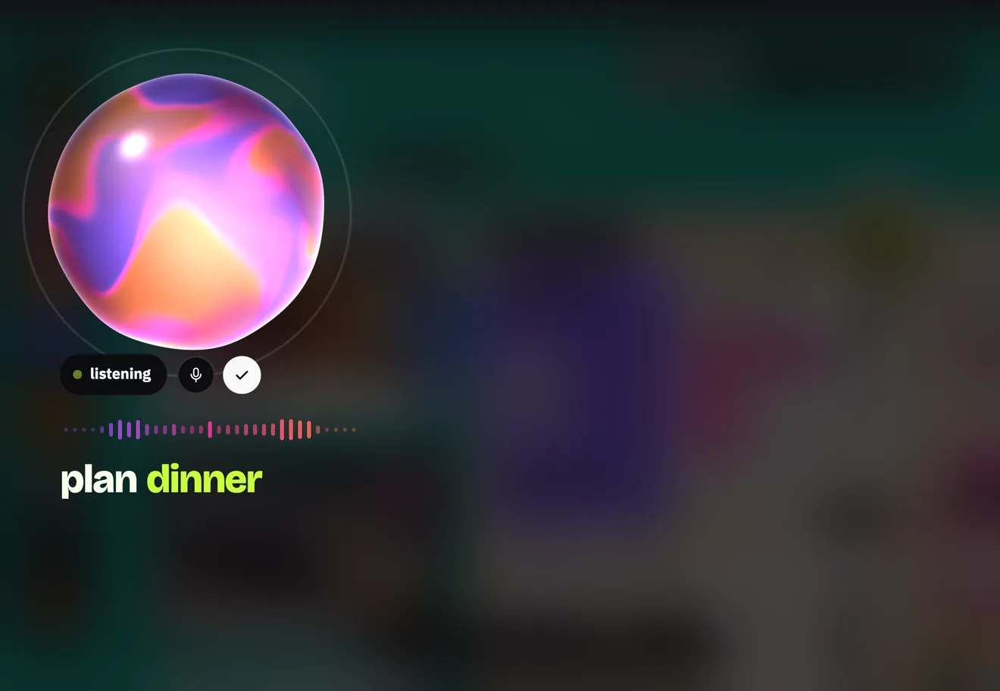

# OurSpaces

> Say "poll for Saturday" and it's on your friends' screens. The AI never cuts in.

A shared board for your group that builds itself when you talk to it. Tap the
orb, say what you need, and the card lands on your screen 610 ms after your
last word (878 ms on everyone else's), filled in by **NVIDIA Nemotron on
Nebius Token Factory**. Then it's a normal card anyone can vote on, claim or drag.

**Live:** https://ourspaces.io · **Built for** the Nebius × NVIDIA Global AI
Hackathon · **By** Thomas Nguyen (build) and Holly Tran (design)

<p align="center"></p>
<p align="center"><sub>"Set up a push-up challenge for the four of us": six linked cards on every screen 1.6 s after the last word.</sub></p>

## What you can say

| You say | What happens on every screen |
|---|---|
| "Add a poll for Saturday dinner" | A real poll, 610 ms after your last word |
| "Add ramen to the dinner poll" | A real ramen place nearby, found on the web by Tavily, in a room that knows its city |
| "Who's driving to Maya's?" | A wheel with exactly the four people who said yes |
| "Set up a push-up challenge for the four of us" | Six linked cards: who's in, a check-in grid, face-down standings, the deal, a countdown |
| "Add a poll for cake flavor" (one exists) | Nothing new; it takes you to that poll |

<p align="center"></p>

## How one ask works

**The model only decides what a model must decide.** It fills every field and
picks the cards for a bigger ask. Code picks the action, places the card,
checks the write, and turns pointers like "the people who are coming" into
real names, so the model can't invent one.


| Model, on Token Factory | Job | Measured |
|---|---|---|
| `nvidia/Nemotron-3_5-Lightning`, thinking off | Plain asks; picks web places | First card in 436 ms (313 ms inside the Convex action) |
| `nvidia/Nemotron-3-Ultra-550b-a55b` | Group-fact asks, multi-card asks, questions | Right cards 15 of 15 on multi-card chains (Lightning: 6 of 15) |
| `nvidia/nemotron-3-super-120b-a12b`, thinking on | Game setup, the weekly email | Nobody waits on it; 1.0 to 1.6 s per game |

- **Why Token Factory.** Thinking is on by default (Lightning spent all 600
  tokens reasoning, 0 valid answers in 6); `chat_template_kwargs.enable_thinking=false`
  turns it off, and the 436 ms rests on that. Four sizes behind one endpoint,
  so moving a job is one constant.
- **It starts before you finish.** A call fires while you're still talking and
  is thrown away if you keep going: about 3 calls per ask, **0.03 cents** for a
  plain one, discarded calls included. p90 657 ms; worst seen 1.85 s, the first
  ask after a deploy.

**What Nemotron adds**, same asks with every model call switched off:

| Test | Rules only | With Nemotron |
|---|---|---|
| Asks that need the group's facts (10) | 1 | 9 |
| Plain asks, fields filled correctly (8) | 2 | 7 |
| The push-up challenge, 10 runs | one empty card | six cards, the right four people, 10 of 10 |

Each space has a page of **what this space knows**: every line shows its
source, and anyone can cross one out.


## Right of way: the AI waits its turn

An AI acting for a group fails one way: it changes what a person is in the
middle of, or undoes a choice they made. **The model proposes; a lease table in
code decides.**

- A **lease** is a person's hand on a card (dragging, typing, holding a vote),
  shown as a halo with their name on every screen.
- An AI change to a held card **waits** as a ghost and lands when they let go.
- A change that would undo a vote or a claim **asks the people who made it**.
- Whoever asked can undo an AI change with one tap.

<p align="center"></p>
<p align="center"><sub>Two phones: Holly holds the dinner poll; Thomas's "add ramen" waits on her, fills in from the web, and lands when she lets go.</sub></p>

**Why not just ask the model?** 162 situations labelled by hand, 64 of them
from our recorded test sessions. Of the 155 clear ones, 107 would change
something a person holds or chose, 48 are harmless.

| Who decides | Harmful writes let through (of 107) | Harmless ones held (of 48) | Time per decision |
|---|---|---|---|
| The gate in code | 0 | 2 | about 1 µs |
| Nemotron Ultra, thinking on | 0 | 3 | 3,063 ms |
| Nemotron Ultra, thinking off | 29 | 8 | 1,075 ms |

The honest loss: Ultra with thinking on let none through on its first, blind
run; the gate's 0 came after fixing the four misses this set named. What code
buys is 3 s and a model call on every write. Two browsers on the deployed app:
**38 of 38** AI changes to a held card waited. Scenarios and a replay: [`eval/right-of-way/`](eval/right-of-way/).

## Who uses it

- **Our house** (Thomas, Holly, Hoa, Hoang and Bumi the dog) has had its room
  since Oct 6, with our real names and facts. **Thomas's fantasy league** moves
  its votes in from Sunday, Oct 11. No counts yet; the counting query is built
  (`pilot:summary`), and the numbers go in this repo when there are any.
- Phones first: the first minute fits a phone screen, and it installs to a
  home screen.
- Games Nemotron sets up from the room's facts, with a shared reveal.

## Where it falls short

- A bigger model alone didn't help: with the group's facts pasted into the
  prompt, Lightning and Ultra both got 1 of 10. Pointers and worked examples
  took it to 9.
- The seeded family room's ten harder asks: 2 right, 5 partly right, 3 wrong.
- Scripted speech, not a real microphone; small tests we wrote ourselves, not
  recordings of real groups.

<p align="center"></p>

## Try it

1. Open [the crew](https://ourspaces.io/#/space/crew) in two tabs. Vote in
   one; the bar moves in the other.
2. Tap the orb and say "add a poll for Friday game night". It lands in both.
3. Grab a card in one tab and ask the orb to change it in the other. The
   change waits until you let go.

## What changed

OurSpaces began Aug 26, 2026 as our Convex All Gas hackathon entry (shared
spaces with live widgets, 319 commits through Sep 21; it won there on Oct 2),
its AI on OpenAI through the Convex AI Gateway. Since Oct 3 (203 commits by
Oct 10): Nemotron on Token Factory behind every chat call, the voice orb and
card deck, Right of Way, the family room, games, Tavily lookups and the pilot
counting query.

## Stack and run

Every chat model call is Nemotron on Token Factory (`convex/nebius.ts`; search
embeddings stay on the Convex AI Gateway) · Convex (database, live sync, auth,
scheduling, the lease table and the Right of Way gate in `convex/rightOfWay.ts`)
· Tavily (real places nearby) · AgentMail (every space has an inbox) ·
Firecrawl (links become cards) · Vite + React + TypeScript · Tailwind v4.

```bash
npm install
npx convex dev        # once, to provision; writes .env.local
npm run dev           # frontend
```

On your Convex deployment: `NEBIUS_API_KEY` for every Nemotron call (without
it the AI returns canned text); `FIRECRAWL_API_KEY` and `AGENTMAIL_API_KEY`,
which `convex/convex.config.ts` requires; `TAVILY_API_KEY`, optional, for the
lookup (add your deployment's name to `LANES` in `convex/tavily.ts`). MIT License.
